# Documento Técnico — Sistema RentCar (Parcial 2 · Programación II)

**Facultad de Ingeniería — Programa de Ingeniería de Sistemas y Computación**  
**Curso:** Programación II  
**Proyecto:** Sistema de Gestión de Alquiler de Vehículos (*RentCar*)  
**Integrantes:** Daniel Esteven Lopez Ordoñez · Juan Felipe Trujillo Urbina  
**Tecnologías:** Java 21, Gradle, JavaFX, FXML, CSS, JUnit 5  

---

## 1. Diagrama UML de Clases

El siguiente diagrama UML de clases representa fielmente las clases, interfaces, enumeraciones y relaciones implementadas en el código fuente del proyecto (`src/main/java/edu/rentcar/...`). La fuente en formato PlantUML también se encuentra disponible en [`docs/UML-RentCar.puml`](UML-RentCar.puml).

```mermaid
classDiagram
    direction TB

    %% MODELOS PRINCIPALES
    class Customer {
        -String id
        -String fullName
        -String email
        -boolean authorized
        +getId() String
        +getFullName() String
        +getEmail() String
        +isAuthorized() boolean
    }

    class Vehicle {
        -String id
        -String brand
        -String model
        -String category
        -int modelYear
        -double dailyRate
        -String status
        +getId() String
        +getDailyRate() double
        +getDisplayName() String
    }

    class RentalMode {
        <<enumeration>>
        BASIC
        STANDARD
        PREMIUM
    }

    class ReservationStatus {
        <<enumeration>>
        PENDING
        CONFIRMED
        REJECTED
        FAILED
    }

    class PaymentStatus {
        <<enumeration>>
        APPROVED
        DECLINED
        UNAUTHORIZED_CUSTOMER
        TECHNICAL_ERROR
        CONNECTION_ERROR
    }

    class ReservationRequest {
        -Customer customer
        -Vehicle vehicle
        -LocalDate startDate
        -LocalDate endDate
        -RentalMode rentalMode
        -List~ServiceComponent~ selectedServices
        -String paymentToken
        +getRentalDays() long
    }

    class Reservation {
        -String id
        -String customerId
        -String customerName
        -String vehicleId
        -String vehicleName
        -LocalDate startDate
        -LocalDate endDate
        -RentalMode rentalMode
        -BigDecimal totalCost
        -String description
        -ReservationStatus reservationStatus
        -String statusMessage
        +transitionTo(ReservationStatus, String) void
        +isConfirmed() boolean
    }

    class PaymentRequest {
        -String reservationId
        -Customer customer
        -BigDecimal amount
        -String paymentToken
    }

    class PaymentResult {
        -PaymentStatus status
        -String message
        -int httpStatusCode
        +isApproved() boolean
        +isDeclined() boolean
    }

    class PricingBreakdown {
        -long rentalDays
        -BigDecimal baseVehicleCost
        -BigDecimal modalityFee
        -BigDecimal coverageCost
        -BigDecimal assistanceCost
        -BigDecimal singleServicesCost
        -BigDecimal packagesCost
        -BigDecimal totalCost
        -String fullDescription
    }

    class RentalOperationResult {
        -boolean success
        -Reservation reservation
        -PricingBreakdown pricingBreakdown
        -PaymentResult paymentResult
        -String userMessage
    }

    %% BUILDER PATTERN
    class ReservationRequestBuilder {
        -Customer customer
        -Vehicle vehicle
        -LocalDate startDate
        -LocalDate endDate
        -RentalMode rentalMode
        -List~ServiceComponent~ selectedServices
        -String paymentToken
        +withCustomer(Customer) ReservationRequestBuilder
        +withVehicle(Vehicle) ReservationRequestBuilder
        +withDates(LocalDate, LocalDate) ReservationRequestBuilder
        +withRentalMode(RentalMode) ReservationRequestBuilder
        +addService(ServiceComponent) ReservationRequestBuilder
        +withPaymentToken(String) ReservationRequestBuilder
        +build() ReservationRequest
    }

    %% COMPOSITE PATTERN
    class ServiceComponent {
        <<interface>>
        +getCode() String
        +getName() String
        +getDescription() String
        +isDailyRate() boolean
        +calculateCost(long rentalDays) BigDecimal
        +getIncludedServiceCodes() Set~String~
    }

    class SingleService {
        -String code
        -String name
        -String description
        -BigDecimal unitPrice
        -boolean dailyRate
        +calculateCost(long rentalDays) BigDecimal
    }

    class ServicePackage {
        -String code
        -String name
        -BigDecimal discountPercentage
        -List~ServiceComponent~ components
        +addComponent(ServiceComponent) ServicePackage
        +removeComponent(ServiceComponent) boolean
        +calculateCost(long rentalDays) BigDecimal
    }

    %% ABSTRACT FACTORY PATTERN
    class RentalModeFactory {
        <<interface>>
        +getRentalMode() RentalMode
        +createRatePolicy() RatePolicy
        +createCoveragePolicy() CoveragePolicy
        +createAssistancePolicy() AssistancePolicy
    }

    class RatePolicy {
        <<interface>>
        +getPolicyName() String
        +calculateBaseVehicleCost(BigDecimal, long) BigDecimal
        +calculateModalityFee(BigDecimal, long) BigDecimal
    }

    class CoveragePolicy {
        <<interface>>
        +getCoverageName() String
        +calculateCoverageCost(long) BigDecimal
        +getIncludedServiceCodes() Set~String~
    }

    class AssistancePolicy {
        <<interface>>
        +getAssistanceName() String
        +calculateAssistanceCost(long) BigDecimal
    }

    class BasicRentalModeFactory
    class StandardRentalModeFactory
    class PremiumRentalModeFactory

    class BasicRatePolicy
    class StandardRatePolicy
    class PremiumRatePolicy

    class BasicCoveragePolicy
    class StandardCoveragePolicy
    class PremiumCoveragePolicy

    class BasicAssistancePolicy
    class StandardAssistancePolicy
    class PremiumAssistancePolicy

    class RentalModeFactoryProvider {
        +getFactory(RentalMode)$ RentalModeFactory
        +registerFactory(RentalModeFactory)$ void
    }

    %% DECORATOR PATTERN
    class BillableRental {
        <<interface>>
        +getRentalDays() long
        +getDescription() String
        +calculateCost() BigDecimal
        +getAppliedServiceCodes() Set~String~
    }

    class BaseVehicleRental {
        -Vehicle vehicle
        -long rentalDays
        -RentalMode rentalMode
        -RatePolicy ratePolicy
        -CoveragePolicy coveragePolicy
        -AssistancePolicy assistancePolicy
        +calculateCost() BigDecimal
    }

    class RentalDecorator {
        <<abstract>>
        #BillableRental wrappedRental
        +calculateCost() BigDecimal
        +getDescription() String
    }

    class AdditionalServiceDecorator {
        -ServiceComponent serviceComponent
        -BigDecimal addedCost
        +calculateCost() BigDecimal
        +getDescription() String
    }

    class GpsServiceDecorator
    class ChildSeatDecorator
    class AdditionalDriverDecorator

    %% ADAPTER & PROXY PATTERNS
    class PaymentGateway {
        <<interface>>
        +processPayment(PaymentRequest) PaymentResult
    }

    class PaymentAdapter {
        +processPayment(PaymentRequest) PaymentResult
    }

    class VerifiedPaymentProxy {
        -PaymentGateway realPaymentGateway
        -CustomerVerificationService verificationService
        +processPayment(PaymentRequest) PaymentResult
    }

    class PaymentApiClient {
        +pay(PaymentApiRequest) PaymentApiResponse
    }

    class CustomerVerificationService {
        +verifyCustomerAuthorization(Customer) boolean
    }

    %% SERVICES, REPOSITORIES & FACADE
    class AvailabilityService {
        +isVehicleAvailable(String, LocalDate, LocalDate) boolean
        +intervalsOverlap(LocalDate, LocalDate, LocalDate, LocalDate)$ boolean
    }

    class PricingService {
        +buildDecoratedRental(ReservationRequest) BillableRental
        +calculateBreakdown(ReservationRequest) PricingBreakdown
    }

    class ReservationRepository {
        +save(Reservation) Reservation
        +findAll() List~Reservation~
        +findConfirmedByVehicleId(String) List~Reservation~
    }

    class RentalFacade {
        -ReservationRepository reservationRepository
        -AvailabilityService availabilityService
        -PricingService pricingService
        -PaymentGateway paymentGateway
        +previewPricing(ReservationRequest) PricingBreakdown
        +isVehicleAvailable(String, LocalDate, LocalDate) boolean
        +processRental(ReservationRequest) RentalOperationResult
        +getAllReservations() List~Reservation~
    }

    class ReservationController

    %% RELACIONES CON CARDINALIDADES (MULTIPLICIDADES)
    ReservationRequestBuilder "1" ..> "1" ReservationRequest : builds
    ReservationRequest "*" --> "1" Customer : customer
    ReservationRequest "*" --> "1" Vehicle : vehicle
    ReservationRequest "*" --> "1" RentalMode : rentalMode
    ReservationRequest "*" o-- "0..*" ServiceComponent : selectedServices

    Reservation "*" --> "1" RentalMode : rentalMode
    Reservation "*" --> "1" ReservationStatus : reservationStatus
    PaymentRequest "*" --> "1" Customer : customer
    PaymentResult "*" --> "1" PaymentStatus : status

    RentalOperationResult "1" --> "0..1" Reservation : reservation
    RentalOperationResult "1" --> "1" PricingBreakdown : pricingBreakdown
    RentalOperationResult "1" --> "0..1" PaymentResult : paymentResult

    SingleService ..|> ServiceComponent
    ServicePackage ..|> ServiceComponent
    ServicePackage "1" o-- "0..*" ServiceComponent : components

    BasicRentalModeFactory ..|> RentalModeFactory
    StandardRentalModeFactory ..|> RentalModeFactory
    PremiumRentalModeFactory ..|> RentalModeFactory

    BasicRatePolicy ..|> RatePolicy
    StandardRatePolicy ..|> RatePolicy
    PremiumRatePolicy ..|> RatePolicy

    BasicCoveragePolicy ..|> CoveragePolicy
    StandardCoveragePolicy ..|> CoveragePolicy
    PremiumCoveragePolicy ..|> CoveragePolicy

    BasicAssistancePolicy ..|> AssistancePolicy
    StandardAssistancePolicy ..|> AssistancePolicy
    PremiumAssistancePolicy ..|> AssistancePolicy

    RentalModeFactory "1" ..> "1" RatePolicy : creates
    RentalModeFactory "1" ..> "1" CoveragePolicy : creates
    RentalModeFactory "1" ..> "1" AssistancePolicy : creates
    RentalModeFactoryProvider "1" o-- "3..*" RentalModeFactory : factories

    BaseVehicleRental ..|> BillableRental
    BaseVehicleRental "*" --> "1" Vehicle : vehicle
    BaseVehicleRental "*" --> "1" RatePolicy : ratePolicy
    BaseVehicleRental "*" --> "1" CoveragePolicy : coveragePolicy
    BaseVehicleRental "*" --> "1" AssistancePolicy : assistancePolicy
    RentalDecorator ..|> BillableRental
    RentalDecorator "1" o-- "1" BillableRental : wrappedRental
    AdditionalServiceDecorator --|> RentalDecorator
    AdditionalServiceDecorator "*" --> "1" ServiceComponent : serviceComponent
    GpsServiceDecorator --|> AdditionalServiceDecorator
    ChildSeatDecorator --|> AdditionalServiceDecorator
    AdditionalDriverDecorator --|> AdditionalServiceDecorator

    PaymentAdapter ..|> PaymentGateway
    PaymentAdapter "1" --> "1" PaymentApiClient : adapts
    VerifiedPaymentProxy ..|> PaymentGateway
    VerifiedPaymentProxy "1" --> "1" PaymentGateway : realPaymentGateway
    VerifiedPaymentProxy "1" --> "1" CustomerVerificationService : verificationService

    AvailabilityService "1" --> "1" ReservationRepository : reservationRepository
    ReservationRepository "1" o-- "0..*" Reservation : reservations

    RentalFacade "1" --> "1" ReservationRepository : reservationRepository
    RentalFacade "1" --> "1" AvailabilityService : availabilityService
    RentalFacade "1" --> "1" PricingService : pricingService
    RentalFacade "1" --> "1" PaymentGateway : paymentGateway
    RentalFacade "1" ..> "0..*" RentalOperationResult : produces
    PricingService "1" ..> "1" RentalModeFactoryProvider : uses
    PricingService "1" ..> "1" BillableRental : builds
    ReservationController "1" --> "1" RentalFacade : rentalFacade
    ReservationController "1" ..> "0..*" ReservationRequestBuilder : uses
```

---

## 2. Análisis del Problema y Pensamiento Computacional

El sistema **RentCar** aborda el problema de gestionar de manera íntegra, extensible y auditable el ciclo de vida del alquiler de vehículos en una aplicación de escritorio bajo arquitectura MVC sin persistencia en base de datos. Para resolverlo con rigor de ingeniería de software, aplicamos las cuatro pilares del **pensamiento computacional**:

### 2.1. Descomposición (*Decomposition*)
El proceso complejo de alquiler se descompuso en subsistemas cohesivos y desacoplados con responsabilidades únicas (Principio de Responsabilidad Única - SRP):
1. **Construcción y validación de la solicitud (`edu.rentcar.builder`)**: Captura y validación de cliente, vehículo, rango de fechas, modalidad, servicios opcionales/paquetes y token de pago antes de iniciar cualquier transacción.
2. **Políticas por modalidad de alquiler (`edu.rentcar.factory`)**: Definición de reglas tarifarias, coberturas de seguro (con deducibles y servicios incluidos sin costo adicional) y asistencia vial según la modalidad (`BASIC`, `STANDARD`, `PREMIUM`).
3. **Modelado de servicios y paquetes (`edu.rentcar.composite` y `edu.rentcar.decorator`)**: Representación jerárquica de servicios individuales y paquetes anidados, junto con su adición dinámica al costo y descripción del alquiler evitando cobros duplicados.
4. **Control de disponibilidad temporal (`edu.rentcar.service.AvailabilityService`)**: Verificación centralizada de intersección de intervalos sobre reservaciones confirmadas.
5. **Seguridad y pasarela de pagos (`edu.rentcar.proxy` y `edu.rentcar.adapter`)**: Verificación obligatoria de autorización del cliente antes de transformar y enviar la petición HTTP al servicio externo `payment-api.jar`.
6. **Coordinación transaccional en memoria (`edu.rentcar.facade.RentalFacade`)**: Orquestación atómica del flujo desde la validación hasta la actualización del estado de la reservación (`PENDING` $\rightarrow$ `CONFIRMED` / `REJECTED` / `FAILED`).

### 2.2. Reconocimiento de Patrones (*Pattern Recognition*)
Durante el análisis se identificaron problemas recurrentes de diseño orientado a objetos:
- **Construcción paso a paso con invariantes complejas**: Construir `ReservationRequest` directamente desde controles JavaFX acoplaba la validación a la vista y requería constructores telescópicos $\rightarrow$ **Patrón Builder**.
- **Familias de políticas acopladas por modalidad**: Cada modalidad requiere una combinación coherente de `RatePolicy`, `CoveragePolicy` y `AssistancePolicy` $\rightarrow$ **Patrón Abstract Factory**.
- **Estructuras de árbol de servicios y paquetes**: Un paquete puede contener servicios simples u otros sub-paquetes y ambos deben calcular su costo de manera uniforme $\rightarrow$ **Patrón Composite**.
- **Combinación explosiva de extras**: Crear subclases de alquiler por cada combinación de GPS, silla infantil, conductor adicional, Wi-Fi o paquetes es inviable ($2^n$ clases) $\rightarrow$ **Patrón Decorator**.
- **Incompatibilidad de interfaces con librería externa**: `PaymentApiClient` utiliza DTOs propios (`PaymentApiRequest`, `PaymentApiResponse` con `double`) y lanza `IOException` / `InterruptedException` $\rightarrow$ **Patrón Adapter**.
- **Control de acceso previo al pago**: La regla de negocio exige que ningún cliente no autorizado dispare llamadas HTTP al proveedor externo $\rightarrow$ **Patrón Proxy (Protection Proxy)**.
- **Acoplamiento entre vista y múltiples servicios**: El controlador gráfico no debe orquestar repositorios, disponibilidad, tarifas, verificación y pagos $\rightarrow$ **Patrón Facade**.

### 2.3. Abstracción (*Abstraction*)
Se definieron contratos limpios mediante interfaces que ocultan los detalles de implementación:
- [`ServiceComponent`](../src/main/java/edu/rentcar/composite/ServiceComponent.java): Abstrae tanto un servicio atómico (`SingleService`) como un paquete compuesto (`ServicePackage`).
- [`BillableRental`](../src/main/java/edu/rentcar/decorator/BillableRental.java): Abstrae cualquier alquiler tarifable sobre el cual se pueden apilar decoradores dinámicamente.
- [`RentalModeFactory`](../src/main/java/edu/rentcar/factory/RentalModeFactory.java), [`RatePolicy`](../src/main/java/edu/rentcar/factory/RatePolicy.java), [`CoveragePolicy`](../src/main/java/edu/rentcar/factory/CoveragePolicy.java) y [`AssistancePolicy`](../src/main/java/edu/rentcar/factory/AssistancePolicy.java): Abstraen las familias de reglas de negocio de cada modalidad.
- [`PaymentGateway`](../src/main/java/edu/rentcar/adapter/PaymentGateway.java): Abstrae el procesamiento de pagos para que tanto el Proxy como el Adapter implementen exactamente el mismo contrato frente a la lógica de negocio.

### 2.4. Diseño Algorítmico (*Algorithmic Thinking*)
- **Algoritmo de intersección de intervalos temporales (`AvailabilityService.intervalsOverlap`)**:
  Dado que una reserva desde `startDate` hasta `endDate` ocupa el intervalo semiabierto $[\text{startDate}, \text{endDate})$ (permitiendo que un vehículo devuelto en la fecha $T$ sea alquilado por otro cliente a partir de esa misma fecha $T$), dos intervalos $[A_{\text{start}}, A_{\text{end}})$ y $[B_{\text{start}}, B_{\text{end}})$ se solapan si y solo si:
  $$A_{\text{start}} < B_{\text{end}} \land B_{\text{start}} < A_{\text{end}}$$
- **Algoritmo de deduplicación y prevención de doble cobro (`AdditionalServiceDecorator`)**:
  Cada `BillableRental` propaga el conjunto `getAppliedServiceCodes()` que inicia con los servicios incluidos gratuitamente por la modalidad (`CoveragePolicy.getIncludedServiceCodes()`, por ejemplo GPS en `STANDARD` y GPS + Conductor Adicional en `PREMIUM`). Al decorar con un servicio individual o con un paquete compuesto, el decorador verifica recursivamente qué códigos de servicio hoja ya están cubiertos y suma únicamente el costo de los servicios no aplicados previamente, redondeando con `BigDecimal` (`RoundingMode.HALF_UP`, escala 2).
- **Algoritmo de prevención de ciclos en paquetes (`ServicePackage.containsHierarchyReference`)**:
  Antes de agregar un `ServiceComponent` a un `ServicePackage`, se realiza un recorrido en profundidad (DFS) sobre los hijos del candidato para garantizar que el paquete contenedor no se agregue a sí mismo directa ni indirectamente.

---

## 3. Explicación Detallada de los Siete Patrones de Diseño

### 3.1. Patrón Builder (Creacional — RF-001)
- **Problema que resuelve:** La creación de una solicitud de alquiler (`ReservationRequest`) involucra múltiples atributos obligatorios y opcionales (cliente, vehículo, fecha de inicio, fecha de fin, modalidad, lista de servicios/paquetes y token de pago) sujetos a validaciones de dominio estrictas que no deben residir en el controlador JavaFX.
- **Justificación:** Permite construir objetos inmutables `ReservationRequest` paso a paso mediante una interfaz fluida, concentrando todas las validaciones de completitud y consistencia temporal en el método `build()`.
- **Clases participantes:**
  - *Builder:* [`edu.rentcar.builder.ReservationRequestBuilder`](../src/main/java/edu/rentcar/builder/ReservationRequestBuilder.java)
  - *Product:* [`edu.rentcar.model.ReservationRequest`](../src/main/java/edu/rentcar/model/ReservationRequest.java)
  - *Client:* [`edu.rentcar.controller.ReservationController`](../src/main/java/edu/rentcar/controller/ReservationController.java)
- **Evidencia en el código:** En `ReservationRequestBuilder.build()` se ejecutan `validateCustomer()`, `validateVehicle()`, `validateDates()`, `validateRentalMode()`, `validateAndDeduplicateServices()` y `validatePaymentToken()`, rechazando nulos, tarifas no positivas o rangos de fechas donde `!endDate.isAfter(startDate)`.
- **Ventajas:** Desacopla la validación de la UI, garantiza la inmutabilidad de `ReservationRequest` y facilita las pruebas unitarias exhaustivas.
- **Limitaciones:** Requiere mantener sincronizados los campos del Builder con los del objeto producto.

### 3.2. Patrón Abstract Factory (Creacional — RF-003)
- **Problema que resuelve:** El sistema ofrece tres modalidades de alquiler (`BASIC`, `STANDARD`, `PREMIUM`), y cada una requiere una familia coherente de políticas de tarifas, coberturas de seguro y asistencia en carretera. Usar condicionales `switch`/`if-else` dispersos por el cálculo de precios rompería el Principio Abierto/Cerrado (OCP).
- **Justificación:** `RentalModeFactory` encapsula la creación de la familia completa de productos (`RatePolicy`, `CoveragePolicy`, `AssistancePolicy`), garantizando que las políticas de una modalidad siempre sean compatibles entre sí.
- **Clases participantes:**
  - *AbstractFactory:* [`RentalModeFactory`](../src/main/java/edu/rentcar/factory/RentalModeFactory.java)
  - *ConcreteFactories:* [`BasicRentalModeFactory`](../src/main/java/edu/rentcar/factory/BasicRentalModeFactory.java), [`StandardRentalModeFactory`](../src/main/java/edu/rentcar/factory/StandardRentalModeFactory.java), [`PremiumRentalModeFactory`](../src/main/java/edu/rentcar/factory/PremiumRentalModeFactory.java)
  - *AbstractProducts:* [`RatePolicy`](../src/main/java/edu/rentcar/factory/RatePolicy.java), [`CoveragePolicy`](../src/main/java/edu/rentcar/factory/CoveragePolicy.java), [`AssistancePolicy`](../src/main/java/edu/rentcar/factory/AssistancePolicy.java)
  - *ConcreteProducts:* `BasicRatePolicy`, `StandardRatePolicy` (+10%), `PremiumRatePolicy` (+20%), `BasicCoveragePolicy` (0 COP/día), `StandardCoveragePolicy` (25,000 COP/día + GPS incluido), `PremiumCoveragePolicy` (45,000 COP/día + GPS y Conductor Adicional incluidos), `BasicAssistancePolicy` (0 COP/día), `StandardAssistancePolicy` (10,000 COP/día), `PremiumAssistancePolicy` (20,000 COP/día).
  - *Registry/Provider:* [`RentalModeFactoryProvider`](../src/main/java/edu/rentcar/factory/RentalModeFactoryProvider.java)
- **Evidencia en el código:** `PricingService` y `ReservationController` obtienen la fábrica mediante `RentalModeFactoryProvider.getFactory(request.getRentalMode())` y crean los tres componentes polimórficamente sin conocer las clases concretas.
- **Ventajas:** Cumple el principio Open/Closed (incorporar una nueva modalidad solo requiere registrar una nueva fábrica en `RentalModeFactoryProvider`) y centraliza las tarifas.
- **Limitaciones:** Incrementa el número de clases e interfaces si se agregan nuevos tipos de políticas a la familia.

### 3.3. Patrón Facade (Estructural — RF-002)
- **Problema que resuelve:** El proceso completo de alquiler requiere coordinar en orden estricto el cálculo de costos, la consulta de disponibilidad, la creación de la reserva en estado `PENDING`, la verificación del cliente, el cobro en la API externa y la transición de estado (`CONFIRMED`, `REJECTED` o `FAILED`) con sincronización concurrente.
- **Justificación:** `RentalFacade` ofrece un punto de entrada único y simplificado (`processRental`, `previewPricing`, `isVehicleAvailable`) para la capa de presentación y las pruebas de integración.
- **Clases participantes:**
  - *Facade:* [`edu.rentcar.facade.RentalFacade`](../src/main/java/edu/rentcar/facade/RentalFacade.java)
  - *Subsystem Classes:* [`ReservationRepository`](../src/main/java/edu/rentcar/repository/ReservationRepository.java), [`AvailabilityService`](../src/main/java/edu/rentcar/service/AvailabilityService.java), [`PricingService`](../src/main/java/edu/rentcar/service/PricingService.java), [`PaymentGateway`](../src/main/java/edu/rentcar/adapter/PaymentGateway.java)
- **Evidencia en el código:** `RentalFacade.processRental(ReservationRequest)` coordina de extremo a extremo el flujo dentro de una sección crítica sincronizada (`synchronized (reservationLock)`), impidiendo condiciones de carrera o reservaciones confirmadas duplicadas.
- **Ventajas:** Reduce drásticamente el acoplamiento de `ReservationController` y permite probar todo el flujo de negocio sin levantar JavaFX.
- **Limitaciones:** Si se agregan demasiadas responsabilidades no relacionadas al Facade, existe el riesgo de convertirlo en una *God Class* (mitigado delegando cada cálculo en servicios especializados).

### 3.4. Patrón Adapter (Estructural — RF-004)
- **Problema que resuelve:** El cliente HTTP suministrado (`com.rentcar.paymentclient.PaymentApiClient` en `libs/payment-client.jar`) expone el método `pay(PaymentApiRequest)` que recibe montos en `double`, devuelve `PaymentApiResponse` con códigos HTTP crudos (`200`, `400`, `503`) y cuerpos de texto (`APPROVED`, `NOT_APPROVED`), y lanza excepciones verificadas (`IOException`, `InterruptedException`). La lógica de negocio necesita trabajar con `BigDecimal` y estados de dominio tipados (`PaymentResult`, `PaymentStatus`).
- **Justificación:** `PaymentAdapter` envuelve a `PaymentApiClient` e implementa la interfaz interna `PaymentGateway`, traduciendo entre el modelo de dominio (`PaymentRequest` $\rightarrow$ `PaymentApiRequest`) y adaptando respuestas y fallos de red en instancias seguras de `PaymentResult`.
- **Clases participantes:**
  - *Target:* [`edu.rentcar.adapter.PaymentGateway`](../src/main/java/edu/rentcar/adapter/PaymentGateway.java)
  - *Adapter:* [`edu.rentcar.adapter.PaymentAdapter`](../src/main/java/edu/rentcar/adapter/PaymentAdapter.java)
  - *Adaptee:* `com.rentcar.paymentclient.PaymentApiClient` (junto con `PaymentApiRequest` y `PaymentApiResponse`)
- **Evidencia en el código:** `PaymentAdapter.processPayment(PaymentRequest)` invoca `PaymentApiClient.pay(...)`, interpreta `response.isApproved()`, `response.isDeclined()`, códigos HTTP `4xx`/`5xx` y captura `IOException`/`InterruptedException`, retornando `PaymentResult` sin filtrar detalles sensibles ni acoplar el dominio al proveedor HTTP.
- **Ventajas:** Aísla por completo la librería externa; permite cambiar el proveedor de pagos o inyectar un doble de prueba (`ExternalPaymentCaller`) sin tocar `RentalFacade`.
- **Limitaciones:** Añade una capa de traducción de objetos por cada petición de pago.

### 3.5. Patrón Decorator (Estructural — RF-005)
- **Problema que resuelve:** Un cliente puede añadir cualquier combinación de servicios opcionales (GPS, silla infantil, conductor adicional, Wi-Fi portátil, pase de peaje o paquetes compuestos) a su alquiler. Crear una jerarquía estática de clases para cada combinación produciría una explosión combinatoria.
- **Justificación:** Permite envolver dinámicamente un `BaseVehicleRental` con uno o varios decoradores (`AdditionalServiceDecorator`, `GpsServiceDecorator`, `ChildSeatDecorator`, `AdditionalDriverDecorator`), acumulando el costo en `BigDecimal` y enriqueciendo la descripción del alquiler en tiempo de ejecución.
- **Clases participantes:**
  - *Component:* [`edu.rentcar.decorator.BillableRental`](../src/main/java/edu/rentcar/decorator/BillableRental.java)
  - *ConcreteComponent:* [`edu.rentcar.decorator.BaseVehicleRental`](../src/main/java/edu/rentcar/decorator/BaseVehicleRental.java)
  - *Decorator:* [`edu.rentcar.decorator.RentalDecorator`](../src/main/java/edu/rentcar/decorator/RentalDecorator.java)
  - *ConcreteDecorators:* [`AdditionalServiceDecorator`](../src/main/java/edu/rentcar/decorator/AdditionalServiceDecorator.java), [`GpsServiceDecorator`](../src/main/java/edu/rentcar/decorator/GpsServiceDecorator.java), [`ChildSeatDecorator`](../src/main/java/edu/rentcar/decorator/ChildSeatDecorator.java), [`AdditionalDriverDecorator`](../src/main/java/edu/rentcar/decorator/AdditionalDriverDecorator.java)
- **Evidencia en el código:** `PricingService.buildDecoratedRental` y `calculateBreakdown` envuelven iterativamente el `BaseVehicleRental` con los decoradores seleccionados, verificando además `getAppliedServiceCodes()` para no cobrar dos veces un servicio ya incluido en la modalidad o paquete.
- **Ventajas:** Flexibilidad total para combinar servicios en tiempo de ejecución y cumplimiento estricto del principio Open/Closed.
- **Limitaciones:** Una cadena larga de objetos envolventes puede ser más compleja de depurar si no se inspecciona cada eslabón.

### 3.6. Patrón Proxy (Estructural — RF-006)
- **Problema que resuelve:** El requisito RF-006 exige verificar que el cliente esté autorizado mediante `CustomerVerificationService` antes de procesar cualquier pago, garantizando que un cliente no autorizado o un fallo de verificación jamás genere tráfico HTTP hacia la API externa.
- **Justificación:** `VerifiedPaymentProxy` implementa la misma interfaz `PaymentGateway` que `PaymentAdapter` (actuando como un *Protection Proxy*). Intercepta `processPayment(PaymentRequest)`, consulta `CustomerVerificationService.verifyCustomerAuthorization(customer)` y solo delega en el `PaymentAdapter` real si la verificación retorna `true`.
- **Clases participantes:**
  - *Subject:* [`edu.rentcar.adapter.PaymentGateway`](../src/main/java/edu/rentcar/adapter/PaymentGateway.java)
  - *Proxy:* [`edu.rentcar.proxy.VerifiedPaymentProxy`](../src/main/java/edu/rentcar/proxy/VerifiedPaymentProxy.java)
  - *RealSubject:* [`edu.rentcar.adapter.PaymentAdapter`](../src/main/java/edu/rentcar/adapter/PaymentAdapter.java)
  - *Collaborator:* [`edu.rentcar.service.CustomerVerificationService`](../src/main/java/edu/rentcar/service/CustomerVerificationService.java)
- **Evidencia en el código:** En `ApplicationServices`, el `RentalFacade` recibe una instancia de `VerifiedPaymentProxy` que envuelve al `PaymentAdapter`. Si `verifyCustomerAuthorization` devuelve `false` o lanza `CustomerVerificationException`, el Proxy retorna `PaymentResult.unauthorizedCustomer(...)` inmediatamente sin invocar `realPaymentGateway.processPayment(request)`.
- **Ventajas:** Separa la política de control de acceso y autorización de la lógica de transporte HTTP y hace imposible omitir la verificación desde el flujo de pago.
- **Limitaciones:** Introduce una indirección adicional antes de llegar al adaptador de pagos.

### 3.7. Patrón Composite (Estructural — RF-007)
- **Problema que resuelve:** El sistema ofrece tanto servicios individuales (`SingleService`) como paquetes promocionales (`ServicePackage`) que agrupan varios servicios e incluso otros paquetes anidados (por ejemplo, `All-Inclusive Touring Package` que contiene `Family Comfort Package` + servicios ejecutivos).
- **Justificación:** Mediante la interfaz común `ServiceComponent`, el cliente (`ReservationRequest`, `AdditionalServiceDecorator`, `PricingService`) trata de forma uniforme un servicio individual y un árbol de paquetes anidados.
- **Clases participantes:**
  - *Component:* [`edu.rentcar.composite.ServiceComponent`](../src/main/java/edu/rentcar/composite/ServiceComponent.java)
  - *Leaf:* [`edu.rentcar.composite.SingleService`](../src/main/java/edu/rentcar/composite/SingleService.java)
  - *Composite:* [`edu.rentcar.composite.ServicePackage`](../src/main/java/edu/rentcar/composite/ServicePackage.java)
  - *Catalog:* [`edu.rentcar.composite.ServiceCatalog`](../src/main/java/edu/rentcar/composite/ServiceCatalog.java)
- **Evidencia en el código:** `ServicePackage.calculateCost(long rentalDays)` recorre recursivamente su lista `components` sumando el costo de cada `ServiceComponent` hijo (aplicando porcentaje de descuento si está configurado) y `addComponent` valida referencias circulares y servicios duplicados.
- **Ventajas:** Simplifica el código cliente (no necesita distinguir entre hoja y paquete para consultar descripción o costo) y permite crear jerarquías arbitrarias de paquetes.
- **Limitaciones:** Requiere validaciones explícitas en `addComponent` para impedir ciclos o duplicidades accidentales en el árbol.
